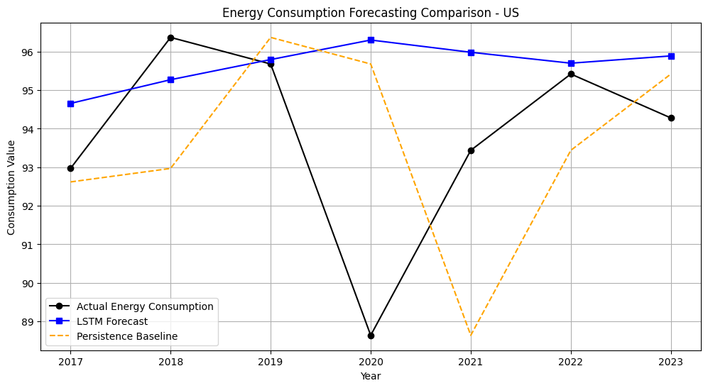

# World Energy Consumption Forecasting using LSTM

[](https://www.python.org/)
[](https://www.tensorflow.org/)
[](https://keras.io/)
[](https://scikit-learn.org/)
[](https://pandas.pydata.org/)
[](https://colab.research.google.com/github/Barathraj009/world-energy-consumption-forecasting/blob/main/World_Energy_Consumption_Forecastin.ipynb)
[](LICENSE)

An end-to-end deep learning framework utilizing a stacked **Long Short-Term Memory (LSTM)** recurrent neural network to model and forecast primary energy consumption trends. Formulated with a **5-year sliding lookback window**, the model is trained and evaluated on 59 years of continuous United States energy records (1965–2023), benchmarked against a classical persistence model, and used to generate an out-of-sample forecast for 2024.

---

## Table of Contents
- [Project Purpose & Objectives](#project-purpose--objectives)
- [End-to-End Workflow](#end-to-end-workflow)
- [Methodology & Mathematical Formulation](#methodology--mathematical-formulation)
  - [Tabular Data Ingestion & Longitudinal Reshaping](#tabular-data-ingestion--longitudinal-reshaping)
  - [Chronological Partitioning & Data Leakage Prevention](#chronological-partitioning--data-leakage-prevention)
  - [Sliding-Window Lookback Compilation](#sliding-window-lookback-compilation)
- [Code Functionality & Notebook Breakdown](#code-functionality--notebook-breakdown)
- [Model Architecture & Hyperparameters](#model-architecture--hyperparameters)
- [Evaluation Metrics & Benchmark Comparison](#evaluation-metrics--benchmark-comparison)
- [Prediction Plot & Visual Analysis](#prediction-plot--visual-analysis)
- [Key Findings & Out-of-Sample 2024 Forecast](#key-findings--out-of-sample-2024-forecast)
- [Interactive Manual Inference Engine](#interactive-manual-inference-engine)
- [Dependencies & Environment Requirements](#dependencies--environment-requirements)
- [Execution Steps](#execution-steps)
  - [Option A: Running on Google Colab (Recommended)](#option-a-running-on-google-colab-recommended)
  - [Option B: Running in a Local Virtual Environment](#option-b-running-in-a-local-virtual-environment)
- [Repository Structure](#repository-structure)
- [License & Academic Citation](#license--academic-citation)

---

## Project Purpose & Objectives

Reliable energy forecasting is vital for utility grid planning, national infrastructure investment, and macro-energy policy formulation. Energy consumption exhibits distinct temporal dependencies, multi-year cyclical patterns, and non-linear shifts driven by technological transformation and global economic shocks.

The core objectives of this project are:
1. **Time-Series Formulation:** Restructure longitudinal national energy records into supervised multi-step sliding input tensors ($X \in \mathbb{R}^{N \times 5 \times 1}$) mapped to next-year target scalars ($y \in \mathbb{R}^N$).
2. **Deep Architecture Design:** Construct an optimized stacked recurrent topology capable of retaining multi-period temporal relationships while mitigating vanishing gradients and overfitting.
3. **Empirical Benchmarking:** Quantify predictive performance gains against a naive persistence baseline ($t-1$) over the out-of-sample test window (2017–2023).
4. **Out-of-Sample Forecasting:** Generate a forward-looking prediction for Year 2024 utilizing the latest 5-year historical horizon (2019–2023).
5. **Interactive Inference:** Provide an interactive, scaling-calibrated prediction interface for arbitrary 5-year sequence inputs.

---

## End-to-End Workflow

The following diagram illustrates the complete data processing, model training, evaluation, and inference pipeline:

```
┌────────────────────────────────────────────────────────┐
│ Raw Dataset: Multi-Country Wide Format (1965-2023 CSV) │
└───────────────────────────┬────────────────────────────┘
                            │
                            ▼
┌────────────────────────────────────────────────────────┐
│  Data Ingestion & Reshaping (pd.melt: Wide to Long)    │
│  Filter Target Country: United States ('US')           │
└───────────────────────────┬────────────────────────────┘
                            │
                            ▼
┌────────────────────────────────────────────────────────┐
│  Chronological 80/20 Train-Test Split (No Shuffling)   │
│  Train: 1965-2011 (47 yrs) | Test: 2012-2023 (12 yrs) │
└───────────────────────────┬────────────────────────────┘
                            │
                            ▼
┌────────────────────────────────────────────────────────┐
│  MinMaxScaler Normalization [0, 1]                     │
│  Fit solely on Train | Transform Train and Test Data   │
└───────────────────────────┬────────────────────────────┘
                            │
                            ▼
┌────────────────────────────────────────────────────────┐
│  Sliding Window Compilation (Lookback = 5 years)       │
│  X_train: (42, 5, 1), y_train: (42,)                   │
│  X_test:  (7, 5, 1),  y_test:  (7,)                    │
└───────────────────────────┬────────────────────────────┘
                            │
                            ▼
┌────────────────────────────────────────────────────────┐
│  Stacked LSTM Architecture Training (100 Epochs)       │
│  LSTM(64) -> Dropout(0.1) -> LSTM(32) -> Dense(1)      │
└───────────────────────────┬────────────────────────────┘
                            │
                            ▼
┌────────────────────────────────────────────────────────┐
│  Model Evaluation & Benchmarking (2017-2023)           │
│  Compare LSTM vs. Persistence Baseline (MAE & RMSE)    │
└──────────────┬──────────────────────────┬──────────────┘
               │                          │
               ▼                          ▼
┌──────────────────────────────┐ ┌──────────────────────────────┐
│  Out-of-Sample 2024 Forecast │ │ Interactive Forecaster Engine│
│  Input 2019-2023 -> 95.8640  │ │ Custom 5-yr input sequence   │
└──────────────────────────────┘ └──────────────────────────────┘
```

---

## Methodology & Mathematical Formulation

### Tabular Data Ingestion & Longitudinal Reshaping

The raw dataset (`World_Energy_By_Country_And_Region_1965_to_2023.csv`) contains historical energy consumption data across multiple nations in wide tabular format:
$$\text{Columns: } [\text{Country}, \text{1965}, \text{1966}, \dots, \text{2023}]$$

The pipeline:
1. Dynamically detects year columns using digit parsing.
2. Melts the dataset from wide format into a longitudinal structure:
   $$\text{Schema: } (\text{country}, \text{year}, \text{energy\_consumption})$$
3. Isolates the target country (`TARGET_COUNTRY = "US"`), cleansing null records and sorting chronologically:
   - **Sample size:** 59 continuous yearly observations ($1965 \le t \le 2023$).
   - **Historical bounds:** Minimum of $51.98$ (1965) to maximum of $97.44$ (2007).

### Chronological Partitioning & Data Leakage Prevention

To strictly respect temporal causality and prevent lookahead data leakage, an **80/20 chronological split** is applied:
- **Training Subset (80%):** 1965 to 2011 (47 observations)
- **Testing Subset (20%):** 2012 to 2023 (12 observations)

Data normalization is conducted using `MinMaxScaler(feature_range=(0, 1))`. Crucially, the scaler is fitted **exclusively on the training partition**:
$$X_{\text{scaled}} = \frac{X - \min(X_{\text{train}})}{\max(X_{\text{train}}) - \min(X_{\text{train}})}$$

The locked parameters ($\min(X_{\text{train}}) = 51.98$, $\max(X_{\text{train}}) = 97.44$) are then applied to transform the test set and any future input sequences without leakage.

### Sliding-Window Lookback Compilation

With a lookback horizon $\tau = 5$ years:
$$X_t = [y_{t-5}, y_{t-4}, y_{t-3}, y_{t-2}, y_{t-1}] \in \mathbb{R}^{5 \times 1}, \quad Y_t = y_t \in \mathbb{R}$$

The dataset compilation generates 3D tensors structured for recurrent neural layers `[Samples, Time Steps, Features]`:

| Tensor Set | Dimension | Time Horizon Evaluated | Description |
| :--- | :---: | :---: | :--- |
| **$X_{\text{train}}$** | `(42, 5, 1)` | 1965–2011 | Training input feature sequences |
| **$y_{\text{train}}$** | `(42,)` | 1970–2011 | Supervised training target values |
| **$X_{\text{test}}$** | `(7, 5, 1)` | 2012–2022 | Testing input feature sequences |
| **$y_{\text{test}}$** | `(7,)` | 2017–2023 | Ground truth test target values |

---

## Code Functionality & Notebook Breakdown

The primary implementation notebook [`World_Energy_Consumption_Forecastin.ipynb`](World_Energy_Consumption_Forecastin.ipynb) is organized into 5 modular, sequentially executable stages:

### Stage 1: Environment Initialization & Interactive Ingestion (Cells 1–12)
- Imports core dependencies: `tensorflow`, `keras`, `pandas`, `numpy`, `matplotlib`, `sklearn`.
- Verifies TensorFlow execution version (`2.21.0`).
- Initializes Google Colab `files.upload()` widget to allow dynamic ingestion of `World_Energy_By_Country_And_Region_1965_to_2023.csv`.

### Stage 2: Data Preprocessing, Reshaping & Country Filtering (Cell 13)
- Identifies country and dynamic year headers.
- Executes `df.melt()` to restructure wide annual columns into a standardized longitudinal format (`country`, `year`, `energy_consumption`).
- Filters countries with $\ge 20$ records and extracts the target series (`TARGET_COUNTRY = "US"`).
- Drops null entries and sorts chronologically, confirming 59 valid observations from 1965 to 2023.

### Stage 3: Temporal Partitioning, Scaling & Tensor Creation (Cell 14)
- Performs 80/20 chronological partition ($split\_idx = 47$).
- Fits `MinMaxScaler` strictly on `train_data`, transforming `train_data` and `test_data`.
- Executes `create_dataset(dataset, lookback=5)` via sliding window iteration.
- Reshapes feature matrices into 3D LSTM tensors: $X_{\text{train}} \in \mathbb{R}^{42 \times 5 \times 1}$, $X_{\text{test}} \in \mathbb{R}^{7 \times 5 \times 1}$.

### Stage 4: Stacked LSTM Construction & Training Loop (Cells 15–18)
- Instantiates a Keras `Sequential` model with stacked LSTM layers and dropout regularization.
- Compiles model with `optimizer='adam'` and `loss='mse'`.
- Trains for 100 epochs (batch size = 4) with simultaneous out-of-sample validation on $(X_{\text{test}}, y_{\text{test}})$.

### Stage 5: Evaluation, Benchmarking, Out-of-Sample Forecasting & Interactive Interface (Cells 19–20)
- Predicts on $X_{\text{test}}$ and inverts predictions back to original domain units via `scaler.inverse_transform()`.
- Calculates Persistence baseline predictions directly from the last window step ($X_{\text{test}}[:, -1, :]$).
- Computes MAE and RMSE metrics for both models.
- Generates an out-of-sample forecast for Year 2024 using the most recent 5-year scaled sequence.
- Renders and exports the comparative visualization `energy_forecast_plot.png`.
- Saves the trained model in native Keras format (`lstm_energy_model.keras`) and tabular predictions to `forecasting_results.csv`.
- Launches an interactive CLI prompt for testing arbitrary 5-year sequence inputs.

---

## Model Architecture & Hyperparameters

```
Input (Shape: [Batch, 5, 1])
  │
  ▼
LSTM Layer 1 (64 units, activation='relu', return_sequences=True)
  │
  ▼
Dropout (rate=0.1)
  │
  ▼
LSTM Layer 2 (32 units, activation='relu', return_sequences=False)
  │
  ▼
Dropout (rate=0.1)
  │
  ▼
Dense Output Layer (1 unit, linear activation)
```

### Layer Specifications

| Layer (Type) | Output Shape | Param # | Description |
| :--- | :--- | :---: | :--- |
| **InputLayer** | `(None, 5, 1)` | 0 | 5 annual time steps with 1 univariate feature |
| **LSTM_1** | `(None, 5, 64)` | 16,896 | First recurrent layer; preserves sequence representation |
| **Dropout_1** | `(None, 5, 64)` | 0 | 10% dropout rate to mitigate recurrent co-adaptation |
| **LSTM_2** | `(None, 32)` | 12,416 | Second recurrent layer; condenses temporal state |
| **Dropout_2** | `(None, 32)` | 0 | 10% dropout rate before dense output |
| **Dense** | `(None, 1)` | 33 | Linear projection to scalar annual consumption |

- **Total Parameters:** 29,345 (114.63 KB)
- **Trainable Parameters:** 29,345 (100%)
- **Non-trainable Parameters:** 0

### Hyperparameters Summary
- **Loss Function:** Mean Squared Error ($\text{MSE} = \frac{1}{n} \sum (y_i - \hat{y}_i)^2$)
- **Optimizer:** Adam ($\alpha = 0.001$)
- **Epochs:** 100
- **Batch Size:** 4
- **Validation Dataset:** Out-of-sample $(X_{\text{test}}, y_{\text{test}})$ evaluated per epoch

---

## Evaluation Metrics & Benchmark Comparison

The model is evaluated on the unseen out-of-sample test window covering **2017 to 2023** ($n=7$ annual targets). Performance is benchmarked against a **Persistence Baseline** (naive model where $\hat{y}_t = y_{t-1}$):

$$\text{MAE} = \frac{1}{n} \sum_{i=1}^n |y_i - \hat{y}_i| \qquad \text{RMSE} = \sqrt{\frac{1}{n} \sum_{i=1}^n (y_i - \hat{y}_i)^2}$$

### Benchmark Comparison Table

| Model | MAE | RMSE | Error Reduction vs. Baseline |
| :--- | :---: | :---: | :---: |
| **Stacked LSTM Network** | **2.1424** | **3.2052** | **-22.70% (MAE) / -10.60% (RMSE)** |
| **Persistence Baseline ($t-1$)** | 2.7714 | 3.5853 | *Reference Baseline* |

---

## Prediction Plot & Visual Analysis

The visual comparison of ground truth consumption versus model forecasts across the 2017–2023 evaluation period is saved as `energy_forecast_plot.png`:



### Key Observations from Evaluation Window:
1. **Pre-Pandemic Stability (2017–2019):** Actual US primary energy consumption remained within the 92.97–96.37 range. The LSTM forecast traced this elevated plateau closely ($94.65 \to 95.80$).
2. **2020 Exogenous Shock:** In 2020, primary energy consumption plummeted to **88.64** due to nationwide COVID-19 pandemic industrial slowdowns and transportation curtailments.
3. **The Lag Penalty of Persistence:** Because the persistence model relies strictly on $y_{t-1}$, it misses structural inflection points:
   - In 2020, persistence predicted an elevated $95.68$ (prior 2019 level), causing a large positive residual.
   - In 2021, when actual consumption rebounded strongly to $93.44$, persistence erroneously projected a continuing collapse at $88.64$.
4. **LSTM Resilience:** The LSTM's 5-year historical memory smoothed out single-period shocks, resulting in lower overall MAE (2.1424 vs. 2.7714) and significantly better trend stability through recovery years (2021–2023).

---

## Key Findings & Out-of-Sample 2024 Forecast

- **Quantitative Gain:** The stacked LSTM network achieved a **22.7% reduction in Mean Absolute Error** and a **10.6% reduction in Root Mean Squared Error** over the baseline model.
- **Robust Generalization:** Regularization via recurrent dropout ($0.1$) prevented the model from overfitting to short-term volatility during the 100 training epochs.
- **Out-of-Sample Year 2024 Forecast:**
  Feeding the latest 5-year historical tensor ($2019\text{--}2023$: `[95.68, 88.64, 93.44, 95.42, 94.28]`) into the trained model produces:

$$\mathbf{\hat{y}_{2024} = 95.8640}$$

This projection indicates sustained post-pandemic stabilization of primary energy consumption in the United States, aligning with historical long-term mean ranges.

---

## Interactive Manual Inference Engine

The notebook includes an interactive user interface for on-the-fly scenario analysis. It accepts any user-defined sequence of 5 consecutive values, maps them through the calibrated MinMax scaler, and computes the 6th-year forecast:

```python
# Example: Custom input sequence
user_input = [90.0, 92.0, 95.0, 91.0, 96.0]

# Scaled and passed to the trained recurrent tensor:
# Output: Predicted Value for Year 6
```

---

## Dependencies & Environment Requirements

The project dependencies are specified in [`requirements.txt`](requirements.txt):

```text
tensorflow>=2.15.0
numpy>=1.23.5
pandas>=2.0.0
scikit-learn>=1.2.0
matplotlib>=3.7.0
```

- **Python Runtime:** Python 3.10 or higher
- **Hardware Compatibility:** CPU-compatible; GPU acceleration supported via TensorFlow CUDA/cuDNN if available.

---

## Execution Steps

### Option A: Running on Google Colab (Recommended)
1. Click the **Open In Colab** badge at the top of this README or open [`World_Energy_Consumption_Forecastin.ipynb`](World_Energy_Consumption_Forecastin.ipynb) in Colab.
2. Run the first cell and upload `data/World_Energy_By_Country_And_Region_1965_to_2023.csv` when prompted by the upload widget.
3. Execute all cells sequentially (`Runtime > Run all`) to reproduce training, metrics, plot generation, and interactive inference.

### Option B: Running in a Local Virtual Environment

1. **Clone the repository:**
   ```bash
   git clone https://github.com/Barathraj009/world-energy-consumption-forecasting.git
   cd world-energy-consumption-forecasting
   ```

2. **Set up a virtual environment:**
   ```bash
   python -m venv venv
   # On Windows:
   .\venv\Scripts\activate
   # On macOS/Linux:
   source venv/bin/activate
   ```

3. **Install dependencies:**
   ```bash
   pip install -r requirements.txt
   ```

4. **Launch Jupyter:**
   ```bash
   jupyter notebook World_Energy_Consumption_Forecastin.ipynb
   ```

---

## Repository Structure

```
world-energy-consumption-forecasting/
├── data/
│   └── World_Energy_By_Country_And_Region_1965_to_2023.csv  # Historical multi-decade energy dataset
├── energy_forecast_plot.png                                 # Actual vs LSTM vs Baseline comparison plot
├── World_Energy_Consumption_Forecastin.ipynb                # Google Colab / Jupyter Notebook source
├── requirements.txt                                         # Python package dependency specifications
├── .gitignore                                               # Standard Python/Jupyter ignore definitions
├── LICENSE                                                  # MIT Open Source License
└── README.md                                                # Comprehensive technical documentation
```

---

## License & Academic Citation

This project is licensed under the MIT License. See [LICENSE](LICENSE) for details.

### Academic Citation
If you use this codebase or methodology for research or evaluation, please cite:

```bibtex
@software{barathraj_energy_lstm_2024,
  author = {Barathraj},
  title = {World Energy Consumption Forecasting using LSTM},
  year = {2024},
  publisher = {GitHub},
  journal = {GitHub repository},
  howpublished = {\url{https://github.com/Barathraj009/world-energy-consumption-forecasting}}
}
```
